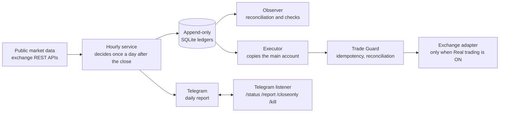
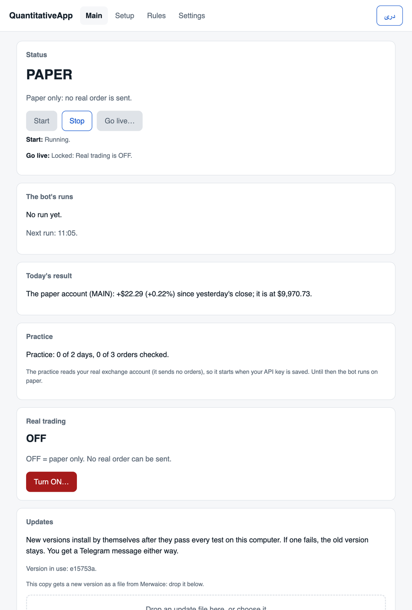
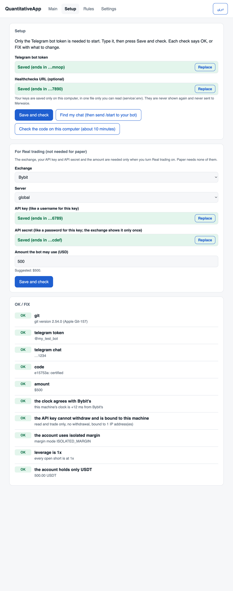
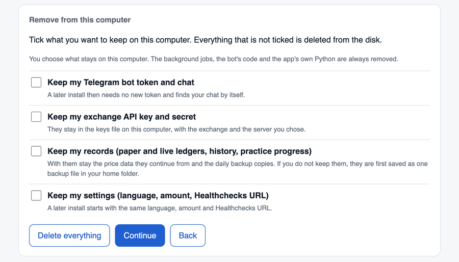

# QuantitativeTrading

**A daily, rules-based crypto trading system, built to be safe before it is fast.**

This repository is a **showcase**. The source code and the strategy are private. What is here explains what the
system does, how it is built, and, above all, how it is tested and kept safe. It includes screenshots and real
incidents that were found and fixed.

> Built by **Merwaice Najafizada** (QA engineer), with teammates in Türkiye. I designed the system, wrote the
> specifications and acceptance criteria, and reviewed and tested everything. Most of the code was written by an AI
> coding agent (Claude Code) working under those specifications. My role was the one a QA lead and system designer has:
> deciding what "correct" means, and proving it.

---

## What it does

- Runs a **once-a-day trading strategy** on crypto spot and perpetual futures. The rules come from a research programme
  covering several years of market history, and are frozen. No rule is tuned once it is in the bot.
- Runs **several paper accounts in parallel**:
  - the main strategy,
  - a challenger variant,
  - "**luck-check twins**", the same rules but with the coins chosen at random, to show how much of a result is skill
    and how much is luck,
  - reference accounts used for information.
- Sends a **daily report** and answers commands on **Telegram**.
- Lets each operator **copy** the main paper account into their **own exchange account** (Bybit or Binance), scaled to
  an amount they choose. This only happens after explicit, typed confirmation at their own computer.
- Ships as a **desktop app for macOS and Fedora Linux**, so people who are not programmers can install it, set it up and
  update it without a terminal.

## Highlights for reviewers

| Area | What was built |
|---|---|
| **Correctness** | Every change must reproduce the research results **to the cent**, in a deterministic replay, before the bot may open a new position |
| **Release gate** | A certificate per commit (all tests plus the replay) and a pre-push hook that refuses any commit without one |
| **Change proof** | Before/after runs on copies of live data, compared **byte for byte**. Every user-facing message is fingerprinted (241 of them) to prove that nothing changed unintentionally. |
| **Safety** | Paper-only by default. Network access is an allowlist of exact endpoints. Live trading needs a local switch **and** typed words at the machine, never from a phone or a script. |
| **Trade Guard** | A separate layer between the strategy and the exchange: no duplicate orders (idempotency), reconciliation of the books against the exchange, and the guarantee that it never blocks a normal order |
| **Distribution** | A one-click installer, self-testing automatic updates with rollback, and **compiled builds signed with Ed25519** |
| **Operations** | Hourly jobs (launchd/systemd), append-only SQLite ledgers, health pings, verified backups, and incident write-ups |

## How it is built

- **Python 3.12**, standard library first; SQLite with full-fsync commits so a power cut cannot corrupt a day.
- **The jobs run separately** (decision, backup, observer, executor, listener), so one failure cannot take the others
  down. The part that can send real orders is the smallest one.
- **Times are in UTC.** The bot decides at the daily close and fills at the next open. Stops are kept in the bot, never
  on the exchange, so live trading behaves exactly like the backtest.

More: [docs/ARCHITECTURE.md](docs/ARCHITECTURE.md)

## How it is kept correct

- **About 900 automated tests** in the CI suite, and about 420 in the certification run on the owner's Mac.
- **A replay to the cent.** Several years of history are replayed through the bot's own code, and the final balances must
  match the research exactly. Any difference, even one cent, blocks the release.
- **Paired runs.** A change that should not alter behaviour is run before and after on copies of the same live data. The
  ledgers, the files and the messages must be **byte-identical**.
- **Fail closed.** Missing data, an uncertified build, or a file that cannot be checked all mean *no new positions*, and
  one clear alert. Exits are always managed.

More: [docs/TESTING.md](docs/TESTING.md) · [docs/SAFETY.md](docs/SAFETY.md)

## The operator app

- **Setup needs only a Telegram bot token.** Exchange keys are asked for only when real trading is turned on.
- **Safety checks before real trading:** the API key cannot withdraw and is bound to one IP address, the account uses
  isolated margin, leverage is 1x, and the computer's clock agrees with the exchange's.
- **Updates install themselves** only after the new version passes its tests **on that computer**. If they fail, the
  old version stays, and the person gets a Telegram message either way.
- **The compiled edition** contains no readable source. Each build is signed on the owner's machine (Ed25519, with keys
  kept in the macOS Keychain), and the bot refuses to trade on any file that does not match the signed list.
- **Remove** lets the person choose what to keep. Deleted records are first saved to a backup file, and keys are never
  copied anywhere.

## Real incidents

Short write-ups of problems that happened while running and testing the system: what was seen, the evidence, the cause,
the fix and how it was proven. [docs/CASE_STUDY.md](docs/CASE_STUDY.md)

- The night the bot stopped: a router outage, macOS privacy rules and a backup that could not be read back
- A button that did nothing: a stale runtime copy after an upgrade
- An "unreliable" test that was perfectly reliable
- A false alarm that every new install would have shown forever
- A real-money risk found by asking "what happens on day one?"

## Technology

Python · SQLite · launchd / systemd · Telegram Bot API · Bybit V5 and Binance REST · Nuitka · Ed25519 · Docker (Fedora
test containers) · GitHub Actions · pytest

## Status

Running on paper every day since November 2026. Operators begin with optional practice (the bot reads their real
account and sends no orders) before trading small real amounts.

*Nothing here is financial advice. The strategy and its results are private.*
