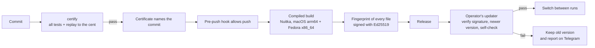

# Architecture

## The pieces

| Piece | Runs | Job |
|---|---|---|
| **Service** | every hour at :05 | After the daily close it fills the day's market data, checks it, closes the previous day (funding, liquidation check, equity mark), decides at the close, fills at the next open, and writes one database transaction per account. Then it sends one report. |
| **Telegram listener** | always on | Answers `/status`, `/report`, `/positions` and the off-switches (`/closeonly`, `/kill`, `/realoff`), each confirmed with a button. Nothing on Telegram can *start* trading. |
| **Backup** | every hour at :25 | Copies the finished day's ledgers with SQLite's backup API, checks each copy row by row, and keeps the last 14. It never copies a secret. |
| **Observer** | every hour at :35 | Replays the day's orders through the Trade Guard on a paper exchange, reconciles the books, and reports differences. It is information only and never changes a decision. |
| **Executor** | every hour at :45 | Copies the main account's orders into the operator's own account, scaled to their amount, through the Trade Guard and an exchange adapter. |
| **Updater** (operator app) | every hour at :50 | Looks for a published release, verifies it, tests it on the computer, and switches only between runs. |

Each piece is its own process and its own scheduled job. A crash in one cannot stop the others, and the code that can
reach a real exchange is kept small and separate.

## Data

- **Append-only SQLite ledgers**, one per account: fills, funding, fees, daily equity, refused and scaled orders. A
  ledger is never rewritten. Faults are fixed going forward, with a note in the log.
- **Commits are written with full fsync**, so a power cut cannot leave a half-written day. A day that was cut off is
  finished from its stored record on the next run.
- **Market data comes from public endpoints only.** Major prices are cross-checked across exchanges within 0.5%, and a day
  with missing data opens no new positions.

## The Trade Guard

A separate package between the strategy and any exchange. The first version was built by a teammate. It provides:
- **Idempotency:** every order has a deterministic ID, so a retry can never place it twice.
- **Reconciliation:** the books are compared with the exchange after each day.
- **No silent blocking:** the guard protects against broken orders and duplicates, but never blocks an order the
  strategy's own rules produce. Live trading has to behave like the backtest.

## Modes

| Mode | Real orders? | What it is |
|---|---|---|
| PAPER | no | the model accounts only |
| REHEARSAL | no | the executor copies into a simulated exchange |
| PRACTICE | no | the executor reads the person's **real** account and checks what it would send |
| LIVE | **yes** | only after the local switch is ON, typed confirmation at the computer, and the start-up checks pass |
| CLOSE-ONLY | exits only | after `/closeonly`, `/kill`, or the switch turned OFF with positions open |

A person's real account starts with **cash only**. Only new entries from their first day on are copied, so nobody
inherits positions at prices the model never paid.

## Release flow

